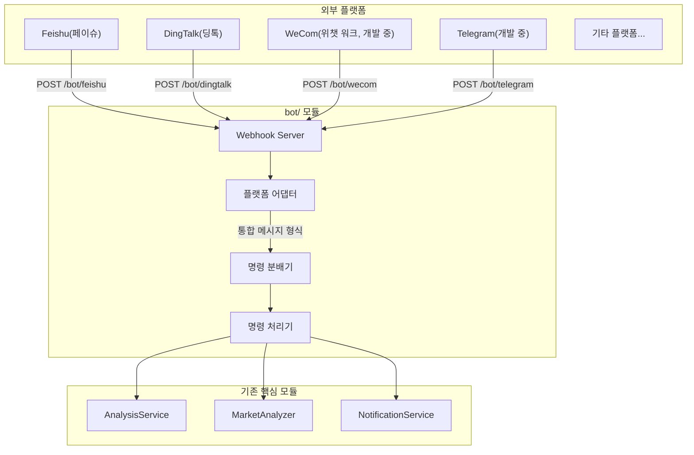

## 1. 전체 설계




## 2. 폴더 구조

프로젝트 루트 폴더에 `bot/` 폴더를 새로 만듭니다.

```
bot/
├── __init__.py             # 모듈 진입점, 주요 클래스 내보내기
├── models.py               # 통합 메시지/응답 모델
├── dispatcher.py           # 명령 분배기(핵심)
├── commands/               # 명령 처리기
│   ├── __init__.py
│   ├── base.py             # 명령 추상 기본 클래스
│   ├── analyze.py          # /analyze 종목/지수 분석
│   ├── market.py           # /market 시장 리뷰
│   ├── help.py             # /help 도움말
│   └── status.py           # /status 시스템 상태
└── platforms/              # 플랫폼 어댑터
    ├── __init__.py
    ├── base.py             # 플랫폼 추상 기본 클래스
    ├── feishu.py           # Feishu(페이슈) 봇
    ├── dingtalk.py         # DingTalk(딩톡) 봇
    ├── dingtalk_stream.py  # DingTalk(딩톡) 봇 Stream 방식
    ├── wecom.py            # WeCom(위챗 워크) 봇 (개발 중)
    └── telegram.py         # Telegram 봇 (개발 중)
```

## 3. 핵심 추상 설계

### 3.1 통합 메시지 모델 (`bot/models.py`)

```python
@dataclass
class BotMessage:
    """통합 봇 메시지 모델"""
    platform: str           # 플랫폼 식별자: feishu/dingtalk/wecom/telegram
    user_id: str            # 보낸 사람 ID
    user_name: str          # 보낸 사람 이름
    chat_id: str            # 대화 ID(그룹 채팅 또는 1:1 채팅)
    chat_type: str          # 대화 유형: group/private
    content: str            # 메시지 텍스트 내용
    raw_data: Dict          # 원본 요청 데이터(플랫폼별)
    timestamp: datetime     # 메시지 시각
    mentioned: bool = False # 봇을 @멘션했는지 여부

@dataclass
class BotResponse:
    """통합 봇 응답 모델"""
    text: str               # 답장 텍스트
    markdown: bool = False  # Markdown 여부
    at_user: bool = True    # 보낸 사람을 @멘션할지 여부
```

### 3.2 플랫폼 어댑터 기본 클래스 (`bot/platforms/base.py`)

```python
class BotPlatform(ABC):
    """플랫폼 어댑터 추상 기본 클래스"""
    
    @property
    @abstractmethod
    def platform_name(self) -> str:
        """플랫폼 식별 이름"""
        pass
    
    @abstractmethod
    def verify_request(self, headers: Dict, body: bytes) -> bool:
        """요청 서명 검증(보안 확인)"""
        pass
    
    @abstractmethod
    def parse_message(self, data: Dict) -> Optional[BotMessage]:
        """플랫폼 메시지를 통합 형식으로 해석"""
        pass
    
    @abstractmethod
    def format_response(self, response: BotResponse) -> Dict:
        """통합 응답을 플랫폼 형식으로 변환"""
        pass
```

### 3.3 명령 기본 클래스 (`bot/commands/base.py`)

```python
class BotCommand(ABC):
    """명령 처리기 추상 기본 클래스"""
    
    @property
    @abstractmethod
    def name(self) -> str:
        """명령 이름 (예: 'analyze')"""
        pass
    
    @property
    @abstractmethod
    def aliases(self) -> List[str]:
        """명령 별칭 (예: ['a', '分析'] — '分析'은 중국어로 '분석', 사용자가 이 글자를 그대로 입력해야 함)"""
        pass
    
    @property
    @abstractmethod
    def description(self) -> str:
        """명령 설명"""
        pass
    
    @property
    @abstractmethod
    def usage(self) -> str:
        """사용법"""
        pass
    
    @abstractmethod
    async def execute(self, message: BotMessage, args: List[str]) -> BotResponse:
        """명령 실행"""
        pass
```

### 3.4 명령 분배기 (`bot/dispatcher.py`)

```python
class CommandDispatcher:
    """명령 분배기 - 싱글턴 패턴"""
    
    def __init__(self):
        self._commands: Dict[str, BotCommand] = {}
        self._aliases: Dict[str, str] = {}
    
    def register(self, command: BotCommand) -> None:
        """명령 등록"""
        self._commands[command.name] = command
        for alias in command.aliases:
            self._aliases[alias] = command.name
    
    def dispatch(self, message: BotMessage) -> BotResponse:
        """메시지를 해당 명령으로 분배"""
        # 1. 명령과 인자 해석
        # 2. 명령 처리기 찾기
        # 3. 실행하고 응답 반환
```

## 4. 지원하는 명령

| 명령 | 별칭 | 설명 | 예시 |

|------|------|------|------|

| /analyze | /a, 分析 | 지정한 종목 또는 등록된 지수 분석 | `/analyze 600519`, `/analyze sh000016`, `/analyze 上证50` |

| /market | /m, 大盘 | 시장 리뷰 | `/market` |

| /batch | /b, 批量 | 관심 종목 일괄 분석 | `/batch` |

| /help | /h, 帮助 | 도움말 표시 | `/help` |

| /status | /s, 状态 | 시스템 상태 | `/status` |

> 별칭 열의 중국어는 봇이 그대로 알아듣는 명령어이므로 번역하지 말고 이 글자 그대로 입력해야 합니다. 뜻은 `分析`=분석, `大盘`=시장 전체(대형 지수), `批量`=일괄, `帮助`=도움말, `状态`=상태입니다. 예시의 `600519`는 A주(중국 본토 증시 상장 주식)의 6자리 종목 코드(구이저우 마오타이)이고, `上证50`은 상하이 증권거래소의 대형주 50개로 구성한 SSE 50 지수의 중국어 이름입니다.

### `/analyze` 지원 범위

- 종목: A주 6자리 숫자(`600519`), 홍콩 주식 `HK+5자리 숫자`(`hk00700`), 미국 주식 영문 1~5자(`AAPL`, `usfd`→`USFD`). 종목 이름(`贵州茅台`, 구이저우 마오타이의 중국어 이름)은 이번 Bot 입구에서 새로 받을 수 있게 되었습니다. 기존 이름 해석기(`resolve_name_to_code`)로 코드를 찾은 뒤 legacy code로 제출하며, 구조화된 target은 함께 보내지 않습니다.
- 등록된 지수: 명시적 코드(`sh000016`), CSI 별칭(`930955.CSI`는 `csi930955`로 정리), 등록된 중국어 이름(`上证50`)을 모두 제출할 수 있습니다. 지수는 구조화된 `AnalysisTarget`으로 분석 Pipeline 끝까지 전달되며, `sh000016`이 `SH000016`으로 바뀌지 않습니다.
- 등록되지 않은 CSI(예: `930956.CSI`), 기존 검사에서 거부하던 코드 형태(예: `12345`, 접두어 없는 `00700`, `600519.SH`, 등록되지 않은 `sh999999`), 알아볼 수 없는 이름: 명확한 오류를 돌려주고 작업을 제출하지 않습니다.
- 등록 목록 안에 같은 이름으로 볼 수 있는 항목이 여러 개라 모호할 때: 명시적 코드를 쓰라고 요청하며, 추측하거나 종목 이름 대체 처리로 넘어가지 않습니다.

### Bot 지수 입구 온라인 E2E smoke(`scripts/smoke_bot_index_entry.py`)

실제 `CommandDispatcher.dispatch_async -> AnalyzeCommand -> TaskService -> StockAnalysisPipeline` 경로를 온라인으로 끝까지 통과시키며 단일 대상을 분석하는 데 씁니다. `SH.000016` / `上证50` / `930955.CSI` 세 가지 매트릭스 시나리오를 다루며, 어떤 webhook transport도 거치지 않습니다(온라인 의존성을 mock하지 않고 dry-run도 하지 않음).

실행(대상 인자 하나, `--timeout` 기본값 900초):

```powershell
.venv\Scripts\python.exe scripts/smoke_bot_index_entry.py "SH.000016"
.venv\Scripts\python.exe scripts/smoke_bot_index_entry.py "上证50"
.venv\Scripts\python.exe scripts/smoke_bot_index_entry.py "930955.CSI"
```

> `"上证50"`은 스크립트가 받아들이는 입력값이므로 중국어 그대로 입력해야 합니다.

프로세스 역할: worker는 별도 하위 프로세스에서 작업을 제출하고 폴링하며(같은 프로세스 안의 `TaskService` 사용), 한 줄짜리 `E2E_EVENT {json}` 이벤트를 출력합니다(`phase=submitted|completed|failed|timeout`, `target` 포함, 단계에 따라 `task_id`/`stock_code`/`result`/`error` 추가). 부모 프로세스는 deadline, 프로세스 트리 정리, 종료 코드(0=성공 / 1=실패 / 124=시간 초과)만 맡습니다.

실패 의미: 작업이 실패했거나, completed이지만 결과가 불완전하면(canonical code나 등록 이름이 매트릭스 기대값과 다르거나, `analysis_summary`/`operation_advice`/`trend_prediction` 중 하나라도 비어 있거나 공백뿐인 경우) `failed` 이벤트를 출력하고 0이 아닌 코드로 종료합니다. 시간이 초과되면 프로세스 트리를 정리합니다(Windows는 `taskkill /T /F`, POSIX는 프로세스 그룹 종료). 정리에 성공하면 `timeout` 이벤트를 출력하고 124로 종료하며, 정리에 실패하면 정리 오류가 담긴 `failed` 이벤트를 출력하고 1로 종료합니다. DB / 보고서 / 알림 등 이미 생긴 부수 효과는 되돌리지 않습니다. 사용자가 Ctrl-C로 중단해도 부모 프로세스가 먼저 프로세스 트리를 정리합니다. 정리에 성공하면 중단 신호를 그대로 전달하고, 실패하면 정리 오류가 담긴 `failed` 이벤트를 출력하고 1로 종료하며, 정리 실패를 조용히 삼키지 않습니다. worker의 기대 code/name은 스크립트에 내장된 매트릭스 기준 매핑에서 가져옵니다(`SH.000016`/`上证50` → `sh000016`/`上证50`, `930955.CSI` → `csi930955`/`红利低波100`; `红利低波100`은 고배당·저변동성 100 지수의 중국어 이름). 응답이나 작업 결과가 스스로 밝힌 식별 정보는 믿지 않습니다. 제출 응답의 `stock_code`가 기대값과 다르면 기대값과 실제값을 함께 담은 명시적 mismatch 오류를 출력합니다(failed 이벤트에도 구조화된 `stock_code` 실제값이 함께 들어감). 매트릭스에 없는 target과 0 이하의 `--timeout`은 제출과 하위 프로세스 spawn 전에 거부됩니다(인자/입력 오류, 종료 코드 2). worker에서 예상치 못한 예외(dispatch/폴링/이벤트 직렬화)가 나면 `failed` 이벤트를 출력하고 1로 종료하며(예외 내용은 stderr에 남음), `KeyboardInterrupt`는 일반 실패로 처리하지 않습니다. 부모 프로세스는 worker의 그 밖의 종료 코드를 모두 1로 바꾸므로, 실행 시 계약은 0 / 1 / 124만 드러냅니다. 부모 프로세스는 내부 `--worker` flag로 하위 프로세스를 명시적으로 띄우며, 환경 변수에 의존하지 않습니다.

사전 조건: 네트워크와 데이터 소스/AI 자격 증명 설정이 모두 갖춰져 있어야 합니다(온라인 경로). 이 스크립트는 오프라인 gate에 속하지 않으며 CI에서 실행하지 않습니다.

## 5. `/status`와 모델 설정 진단 안내

### 설정 계층과 사용 가능 여부 판단 기준

- `/status`에 표시되는 LLM 사용 가능 여부는 시스템 공통 실행 우선순위를 따릅니다.
  - `LITELLM_CONFIG`(LiteLLM YAML)
  - `LLM_CHANNELS`
  - legacy provider 키(`GEMINI_API_KEY` / `OPENAI_API_KEY` / `ANTHROPIC_API_KEY` / `DEEPSEEK_API_KEY`)
- 주 모델(`LITELLM_MODEL` 또는 `AGENT_LITELLM_MODEL`)에 현재 활성화된 계층에서 쓸 수 있는 공급원이 없으면 "AI 서비스가 설정되지 않음"을 표시하고, 사용자가 볼 수 있는 원인 줄을 함께 남깁니다.
- 이 저장소 `requirements.txt`의 실행 의존성 조건은 `litellm>=1.80.10,!=1.82.7,!=1.82.8,<1.99.0`이며, 이 범위 안에서는 이 경로가 기존 호환 동작을 따릅니다.
- 이 진단 규칙은 `GET /api/v1/system/config/setup/status`의 LLM 검사와 같습니다. `LITELLM_CONFIG`/`LLM_CHANNELS`가 높은 우선순위이며, 방식을 바꿀 때 조용히 이전하지 않습니다. 예전 방식으로 돌아가려면 사용자가 예전 값을 직접 되살리거나 롤백해야 합니다.

### 대체와 이전의 경계

- `LITELLM_CONFIG`나 `LLM_CHANNELS` 중 하나라도 적용되면, 그 아래 계층의 legacy 설정은 무시됩니다(이번 호출의 공급원으로 계속 쓰이지 않음).
- 진단 기능 강화는 조용한 이전(silent migration)을 하지 않습니다. `GEMINI_*`, `OPENAI_*`, `ANTHROPIC_*`, `LITELLM_*`의 예전 값을 스스로 비우거나 지우지 않고, 사용 가능 여부 진단에서 알려 주기만 합니다.

### 공식 호환 자료(문제 해결 시 대조용)

- LiteLLM 공식 사이트: <https://docs.litellm.ai/>
- LiteLLM OpenAI Compatible 안내: <https://docs.litellm.ai/docs/providers/openai_compatible>
- OpenAI Chat API: <https://platform.openai.com/docs/api-reference/chat>
- DeepSeek API 문서: <https://api-docs.deepseek.com/>
- Kimi Moonshot 호환 안내: <https://platform.moonshot.ai/docs/guide/compatibility>
- Gemini OpenAI 호환 안내: <https://ai.google.dev/gemini-api/docs/openai>
- Ollama API 문서: <https://github.com/ollama/ollama/blob/main/docs/api.md>

## 6. Webhook 라우트

[api/v1/router.py](../api/v1/router.py)에서 라우트를 등록합니다.

```python
# Webhook 라우트
/bot/feishu      # POST - Feishu(페이슈) 이벤트 콜백
/bot/dingtalk    # POST - DingTalk(딩톡) 이벤트 콜백
/bot/wecom       # POST - WeCom(위챗 워크) 이벤트 콜백 (개발 중)
/bot/telegram    # POST - Telegram 업데이트 콜백 (개발 중)
```

## 설정

[config.py](../src/config.py)에 봇 설정을 추가합니다.

```python
# === 봇 설정 ===
bot_enabled: bool = False              # 봇 사용 여부
bot_command_prefix: str = "/"          # 명령 접두어

# Feishu(페이슈) 봇(이벤트 구독)
feishu_app_id: str                     # 기존 항목
feishu_app_secret: str                 # 기존 항목
feishu_verification_token: str         # 신규: 이벤트 검증 Token
feishu_encrypt_key: str                # 신규: 암호화 키

# DingTalk(딩톡) 봇(앱)
dingtalk_app_key: str                  # 신규
dingtalk_app_secret: str               # 신규

# WeCom(위챗 워크) 봇(개발 중)
wecom_token: str                       # 신규: 콜백 Token
wecom_encoding_aes_key: str            # 신규: EncodingAESKey

# Telegram 봇(개발 중)
telegram_bot_token: str                # 기존 항목
telegram_webhook_secret: str           # 신규: Webhook 비밀 키
```

## 확장 안내
### 알림 플랫폼을 새로 추가하는 방법

1. `bot/platforms/`에 새 파일을 만듭니다.
2. `BotPlatform` 기본 클래스를 상속합니다.
3. `verify_request`, `parse_message`, `format_response`를 구현합니다.
4. 라우트에 Webhook 엔드포인트를 등록합니다.

### 명령을 새로 추가하는 방법

1. `bot/commands/`에 새 파일을 만듭니다.
2. `BotCommand` 기본 클래스를 상속합니다.
3. `execute` 메서드를 구현합니다.
4. 분배기에 명령을 등록합니다.

## 보안 관련 설정

- 명령 빈도 제한(과다 요청 방지)을 지원합니다.
- 민감한 작업(예: 일괄 분석)에는 권한 화이트리스트를 둘 수 있습니다.

[config.py](../src/config.py)에 봇 보안 설정을 추가합니다.

```python
    bot_rate_limit_requests: int = 10     # 빈도 제한: 시간 창 안의 최대 요청 수
    bot_rate_limit_window: int = 60       # 빈도 제한: 시간 창 길이(초)
    bot_admin_users: List[str] = field(default_factory=list)  # 관리자 사용자 ID 목록, 민감한 작업 제한
```
