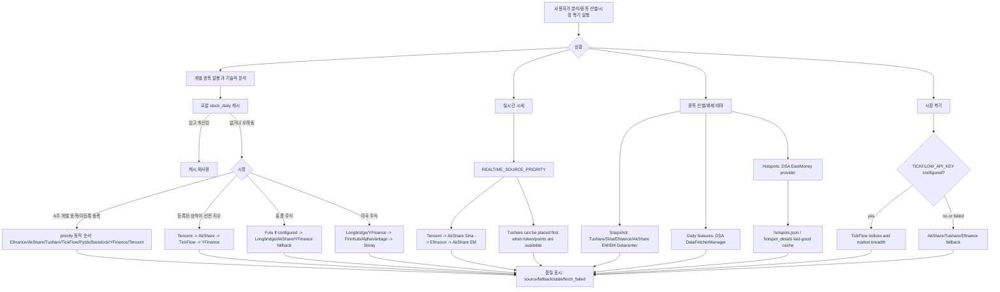
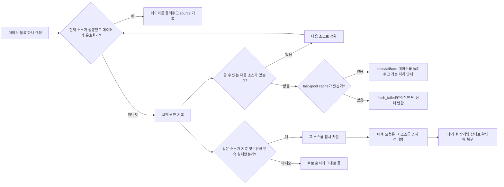
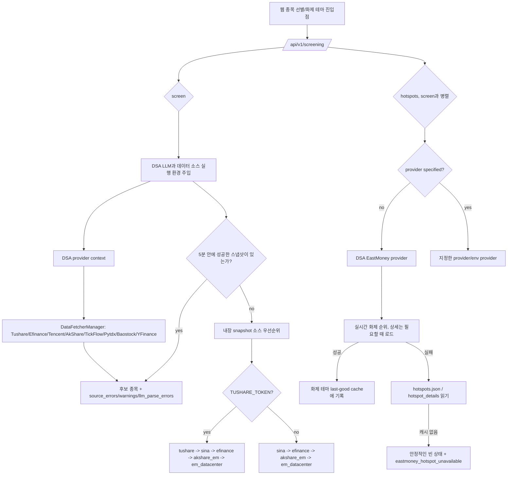

# 데이터 소스 안정성과 장애 대응 도해

이 문서는 사용자, 배포 담당자, 관리자를 위해 DSA에 연결된 데이터 소스가 분석, 종목 선별, 시장 복기에 어떻게 쓰이는지, 데이터 소스가 실패하면 시스템이 어떻게 기능을 낮춰 대응하는지 설명합니다.

핵심 원칙: 먼저 프로젝트에 이미 연결되어 검증된 데이터 소스로 실패 경로를 분명히 설명합니다. 새 외부 데이터 소스는 두 번째 단계로 미뤄, 관리 범위가 먼저 커지지 않게 합니다.

이 문서의 데이터 소스 대부분은 중국 본토 A주(중국 본토 주식)용입니다. 한국 주식(`.KS`/`.KQ`)은 YFinance를 통해 조회되며, 범위는 [시장 지원 범위](market-support.md)를 보세요.

## 기본적 분석의 보고 기간과 종목 범위

AkShare의 실적 예고(业绩预告)와 실적 속보(业绩快报)는 `date=YYYYMMDD`로 조회하는 전체 시장 표이고, 기관 보유 현황은 "연도+분기"로 조회합니다. 어댑터는 이미 끝난 최근 두 분기를 차례로 시도하고, 돌려주기 전에 현재 종목만 걸러 냅니다. 표에 대상 종목이 없거나 코드 열이 없으면 그 전 기간을 시도하며, 다른 종목의 첫 행을 쓰거나 API에 내장된 몇 년 전 기본 날짜로 돌아가지 않습니다. 10대 주주 조회는 기존의 상하이/선전/베이징 코드 변환을 재사용해, 시장 접두사가 붙은 종목과 보고 기간을 명시해 넘깁니다.

기관 추천은 기관 보유 변화를 뜻하지 않고, 일반 주주 수도 10대 주주 보유 변화를 뜻하지 않습니다. 이렇게 의미가 다른 데이터는 더 이상 해당 필드의 대체 출처로 쓰지 않습니다. 실적 보고서도 더 이상 실적 예고를 대신하지 않습니다. 공시가 없거나, 데이터가 빠졌거나, 상위 소스 해석에 실패하면 부분 데이터와 오류 진단을 남깁니다. `partial` 자체가 데이터를 모두 못 가져왔다는 뜻은 아닙니다. 이 수정은 시간 초과 예산, 일반 일봉 데이터 소스 우선순위, API/리포트 필드, 사용자 설정을 바꾸지 않으며, 상위 둥팡차이푸(East Money)의 응답 구조가 언제나 쓸 수 있다고 보장하지도 않습니다.

실적 속보 요약은 실제로 돌아온 매출, 순이익, 전년 대비 증감, 주당순이익, 자기자본이익률로만 만들며, 0과 음수 값도 그대로 둡니다. 공시 날짜는 속보 내용으로 보지 않습니다. 실적 예고는 명시된 공시 텍스트 필드에서 뽑으며, 날짜나 변동 폭 숫자를 요약으로 쓰지 않습니다. 날짜만 있거나 지표가 모두 없으면 유효한 요약을 만들지 않아, 캐시와 Agent 출력이 메타데이터를 실적 정보로 착각하지 않게 합니다.

## 사용자에게 한마디로 답하기

"데이터 소스 실패"를 만났다면, 보통 시스템이 소스를 하나만 쓸 수 있어서가 아니라 무료 소스가 요청 제한에 걸렸거나, 상위 API가 잠시 바뀌었거나, 네트워크가 흔들렸거나, 현재 시장/종목을 지원하지 않기 때문입니다. DSA에는 여러 데이터 소스 fallback이 들어 있어 상황에 따라 다음 소스를 자동으로 시도합니다. 더 안정적으로 쓰려면 token 방식의 안정적인 소스를 하나 이상 설정하는 것을 권장합니다.

- A주 개별 종목과 종목 선별: `TUSHARE_TOKEN`을 우선 설정하고, AkShare / Efinance / Tencent / TickFlow / Baostock / YFinance를 대체 소스로 남겨 둡니다. 일반 개별 종목 일봉은 priority 설정 순서를 따릅니다.
- 등록된 A주 지수: Tencent → AkShare → TickFlow → YFinance 순서로 고정해 기능을 낮추며, 일반 일봉의 `*_PRIORITY` 설정은 읽지 않습니다.
- A주 시장 복기: `TICKFLOW_API_KEY`를 설정하면 복기 집계에 필요한 지수와 시장 폭은 TickFlow를 먼저 시도하고, 실패하면 기존 무료 소스로 돌아갑니다. 이는 개별 지수 일봉의 Tencent 우선 고정 순서와는 다른 진입점입니다.
- 홍콩 주식: `FUTU_OPEND_HOST`를 설정하면 Futu를 홍콩 주식 실시간 시세와 기본적 분석의 주 소스로 쓸 수 있습니다. `FUTU_HK_REALTIME_SOURCE_PRIORITY`로 홍콩 실시간 시세 순서를 정하며, Longbridge, AkShare, YFinance는 fallback으로 남습니다.
- 미국 주식: `LONGBRIDGE_*`를 설정하면 Longbridge를 우선 쓸 수 있고, YFinance는 실시간 주 경로의 fallback으로 남습니다. Finnhub, AlphaVantage는 주 소스가 시세를 돌려준 뒤 필드를 보충하거나 일봉 경로에 참여할 뿐이며, Longbridge/YFinance가 모두 실패했을 때 혼자서 실시간 시세를 돌려주지는 못합니다.
- 화제 테마: 종목 선별의 화제 테마 구현은 AlphaSift를 참고했으며, 기본으로 EastMoney provider를 쓰고 로컬 last-good cache로 실시간 API 실패의 영향을 줄입니다.

## 연결된 데이터 소스 표

| 상황 | 연결된 소스 | 기본 사용 방식 | 실패 처리 |
| --- | --- | --- | --- |
| A주 개별 종목 일봉 / 기술적 분석 | Efinance, Tencent, AkShare, Tushare, TickFlow, Pytdx, Baostock, YFinance | `DataFetcherManager`가 priority 순서대로 시도합니다. `TUSHARE_TOKEN`을 설정하면 Tushare가 자동으로 후보 소스에 들어갑니다 | 한 소스가 실패하면 다음 소스를 시도하고, 연속으로 실패하면 그 소스를 잠시 차단합니다 |
| 등록된 A주 지수 일봉 / 기술적 분석 | Tencent, AkShare, TickFlow, YFinance | 현재 `IndexRegistry`에 등록된 5개 종목은 Tencent → AkShare → TickFlow → YFinance 순서로 고정해 시도하며, 일반 일봉의 `*_PRIORITY` 설정은 읽지 않습니다 | 미설정, 차단, 예외, 빈 결과 모두 다음 소스로 넘어갑니다. 모두 실패하면 빈 결과를 돌려주고 종합 경고를 기록합니다 |
| A주 실시간 시세 | Tencent, AkShare Sina, Efinance, AkShare EM, Tushare | `REALTIME_SOURCE_PRIORITY`로 순서를 정하며, 기본값은 Tencent / Sina 같은 가벼운 소스 쪽입니다 | 실패한 소스는 `fallback_from`에 기록하고, 성공한 소스가 결과를 돌려줍니다 |
| A주 시장 복기 | TickFlow, AkShare, Tushare, Efinance | `TICKFLOW_API_KEY`를 설정하면 복기 집계의 주요 지수와 시장 폭은 TickFlow를 먼저 시도합니다. 개별 지수 일봉 순서와는 다릅니다 | TickFlow 권한이 부족하거나 실패하면 AkShare / Tushare / Efinance 경로로 돌아갑니다 |
| 종목 선별 스냅샷 | Tushare, Sina, Efinance, AkShare EM, EastMoney Datacenter | `TUSHARE_TOKEN`이 있으면 `tushare`를 스냅샷 우선순위에 자동으로 넣고, 없으면 무료 소스 경로를 씁니다 | 선별 엔진이 source health를 관리하며, 상태 API가 snapshot/daily health를 보여 줍니다 |
| 종목 선별 일봉 특징 보충 | `DataFetcherManager` | 선별 엔진은 기존 일봉과 캐시 경로를 먼저 재사용합니다 | 기존 경로가 실패한 뒤에만 엔진 자체의 일봉 소스로 돌아갑니다 |
| 종목 선별 화제 테마 | EastMoney provider, AlphaSift를 참고한 hotspot 구현, last-good cache | provider를 지정하지 않으면 기본으로 EastMoney provider를 씁니다 | 실시간 조회가 실패하면 화제 테마 캐시로 돌아가고, 캐시가 없으면 안정적인 빈 상태와 읽을 수 있는 오류를 돌려줍니다 |
| 홍콩 주식 | Futu, Longbridge, YFinance, AkShare, Tushare | `FUTU_OPEND_HOST`를 설정하면 Futu가 실시간 시세와 기본적 분석의 주 소스가 되며, `FUTU_HK_REALTIME_SOURCE_PRIORITY` 순서대로 시도합니다 | Futu가 실패하면 Longbridge / AkShare / YFinance로 돌아가고, Longbridge가 대기 중이거나 실패하면 YFinance / 다른 사용 가능한 소스로 계속 넘어갑니다 |
| 미국 주식 | Longbridge, YFinance, AkShare, Tushare, Finnhub, AlphaVantage, Stooq | Longbridge 자격 증명을 설정하면 미국 주식 일봉/실시간 주 경로에 참여하고, YFinance는 실시간 기본 fallback을 유지합니다. Finnhub/AlphaVantage는 이미 받은 시세 필드를 보충하고 일봉 경로에 참여할 수 있습니다 | Longbridge가 대기 중이거나 실패하면 실시간 주 경로는 YFinance로 돌아갑니다. 둘 다 실패해도 보조 소스를 혼자 시세를 돌려줄 수 있는 fallback처럼 꾸미지 않습니다 |

## 통합 데이터 기능 읽기 전용 계약

Web/API는 `GET /api/v1/data/overview`와 같은 기능의 별칭 `GET /api/v1/data/capabilities`를 제공해, 데이터 소스 기능, 데이터셋 품질, 상황별 우선순위를 하나의 읽기 전용 구조로 홈 대시보드, 데이터 센터, 개별 종목 상세, 관심 종목, 종목 선별 페이지에 보여 줍니다.

첫 버전 계약은 설정과 `DataFetcherManager`의 fetcher 스냅샷만 읽으며, 외부 시세 요청을 보내지 않고 원본 키도 돌려주지 않습니다. 응답은 세 계층으로 나뉩니다.

- `providers`: provider마다 `enabled`, `configured`, `status`, `markets`, `datasets`, 정확한 `dataset_markets`, 민감하지 않은 warning. `markets`와 `datasets`는 묶음 색인일 뿐이며, 둘을 곱해 모든 조합을 지원한다고 추정하면 안 됩니다. 예를 들어 YFinance는 A주 시세에 참여할 수 있지만 A주 기본적 분석은 항상 AkShare를 쓰므로 `dataset_markets.financial.snapshot`에는 `cn`이 없습니다. Finnhub/AlphaVantage의 미국 주식 시세 handler는 현재 Longbridge/YFinance가 주 시세를 돌려준 뒤에만 필드를 보충하므로 `quote.realtime` 독립 라우팅 기능을 선언하지 않습니다.
- `datasets`: `quote.realtime`, `kline.daily`, `index.daily`, `market.overview`, `financial.snapshot`, `news.events`, `strategy.screening`, `alert.monitor`, `portfolio.account`의 `status/source/fallback_from/stale/warnings`. 이 가운데 `quote.realtime`, `kline.daily`, `market.overview`, `financial.snapshot`은 모두 시장별 coverage를 모아, 한 시장의 상태를 전체가 쓸 수 있다고 잘못 알리지 않게 합니다. A주 실시간은 `cn` 종목 우선순위, `cn.index.exchange` 고정 지수 경로, `cn.index.csi` Efinance 전용 경로로 더 나뉘고, 미국 주식 실시간은 `us` 개별 종목 동적 우선순위와 `us.index` 고정 YFinance 전용 경로로 나뉩니다. AkShare Tencent/Sina/EM, AkShare HK 두 하위 소스, Efinance 종목/지수 하위 소스 단위 차단과 일봉 breaker는 provider 전체의 unknown 판정보다 먼저 적용되어, overview가 실행 중 건너뛰는 동작과 일치합니다. YFinance의 홍콩 실시간 선언은 실제 `.HK` 실행 경로에 해당합니다. OpenD를 설정하지 않으면 HK priority는 실행 환경과 마찬가지로 Futu를 건너뜁니다. 미국 개별 종목 실시간도 현재 요청에서 쓸 수 있는지에 따라 연결 대기 중인 Longbridge를 건너뛰어, YFinance가 가짜 fallback이 아니라 실제 주 소스가 됩니다. PyTDX는 통합 route에 연결되지 않은 실시간 기능을 선언하지 않으며, YFinance 지수 일봉은 실제로 실행할 수 있는 CN/US route만 선언합니다. 실행 순서대로 시도하는 데이터셋은 첫 우선 소스를 아직 확인하지 않았고 더 구체적인 open breaker 근거도 없으면 `unknown`을 유지하며, 뒤쪽 소스가 선택되었다고 건너뛰어 주장하지 않습니다. `alert.monitor`는 스위치가 켜져 있고 현재 API 프로세스의 scheduler가 `agent_event_monitor`를 실제로 등록해 실행 중일 때만 `ok`입니다. 스위치가 꺼져 있으면 `agent_event_monitor_disabled`, scheduler가 실행 중이 아니면 `agent_event_monitor_not_running`을 돌려줍니다.
- `priorities`: `cn.realtime`, `hk.realtime`, `us.realtime`, `daily.generic`, `cn.index.daily`, `market.overview`, `screening.snapshot`, `news.events`의 현재 source 순서. `daily.generic`은 실행 환경과 마찬가지로 현재 요청에서 쓸 수 없거나 연결 대기 중인 fetcher를 먼저 빼며, 건너뛴 데이터 소스를 fallback으로 기록하지 않습니다.
- `index.daily`는 `cn.exchange`, `cn.csi`, `us` coverage를 따로 구분합니다. 상하이·선전 거래소 지수는 Tencent, AkShare, TickFlow, YFinance 고정 다중 소스 경로를 쓰고, CSI 지수는 실행 계약에 따라 AkShare만 인정하며, 미국 지수는 현재 지수 symbol을 받을 수 있는 YFinance만 선언합니다. Finnhub의 현재 fetcher는 지수 symbol을 거부하므로 가짜 fallback으로 쓰지 않습니다. Tushare는 지수 일봉 기능을 선언하지 않습니다. CN/HK realtime은 모두 실제로 실행 handler가 있는 source token만 받으며, Tushare realtime 기능은 A주에만 선언합니다.

여기서 `unknown`은 실행 중 확인을 아직 하지 않았다는 뜻이고, `unconfigured`는 필요한 설정이 없다는 뜻이며, `degraded`는 앞쪽 우선 소스는 쓸 수 없지만 뒤쪽 소스는 아직 쓸 수 있다는 뜻입니다. 종목 선별 source health는 콜드 스타트 때, 성공 수와 실패 수가 모두 0이면 `unknown`을 유지하며, 아직 호출하지 않은 데이터 소스를 미리 `ok`로 표시하지 않습니다. 나중에 Data Center는 같은 구조에 last_success, coverage, cooldown, 실행 이력을 덧붙일 수 있으므로, 페이지마다 데이터 품질 기준을 따로 관리할 필요가 없습니다.

## 전체 흐름도



## 실패와 기능 저하 흐름도



현재 일봉 소스 차단 정책은 3번 연속 실패하면 약 5분 동안 잠시 쉬게 하는 것입니다. 데이터 소스를 영구히 끄려는 것이 아니라, 잠깐 쓸 수 없는 소스 하나 때문에 전체 분석이 느려지는 일을 막기 위한 것입니다.

## 종목 선별과 화제 테마 흐름



## 권장 설정 조합

### 무료 모드

개인적으로 써 보기에 알맞으며, 무료 소스의 자동 fallback에 기댑니다. token이 필요 없다는 것이 장점이고, 상위 소스의 요청 제한이나 일시적인 API 변경을 더 자주 만난다는 것이 단점입니다.

```env
REALTIME_SOURCE_PRIORITY=tencent,akshare_sina,efinance,akshare_em
ENABLE_EASTMONEY_PATCH=true
```

### A주 안정 모드

종목 선별이나 일괄 분석을 자주 돌리거나 외부에 서비스할 때 알맞습니다. Tushare는 일반 A주 일봉과 스냅샷의 안정성을 높이고, TickFlow는 일반 A주 일봉, 등록 지수의 고정 fallback, 실시간 시세, 시장 복기를 강화합니다(실시간 시세는 `REALTIME_SOURCE_PRIORITY`에 명시적으로 넣어야 함). 무료 소스는 계속 대체 소스로 남습니다.

```env
TUSHARE_TOKEN=your_tushare_token
TICKFLOW_API_KEY=your_tickflow_key

REALTIME_SOURCE_PRIORITY=tickflow,tushare,tencent,akshare_sina,efinance,akshare_em
SNAPSHOT_SOURCE_PRIORITY=tushare,sina,efinance,akshare_em,em_datacenter

# 종목 선별 실행 시 기본값. 명시적으로 설정하면 그 값을 유지합니다
DAILY_FETCH_RETRIES=3
DAILY_FETCH_MAX_WORKERS=1
```

주의: TickFlow 기능은 요금제 권한에 따라 단계가 나뉩니다. 권한이 부족하거나 요청이 실패하면 fail-open으로 기존 무료 소스로 돌아가므로, 모든 시장 시세의 유일한 출처로 쓰는 것은 권장하지 않습니다.

### 홍콩 / 미국 주식 안정 모드

홍콩·미국 주식 포트폴리오, 보유 종목, 개별 종목 분석에 알맞습니다. Longbridge를 설정하면 홍콩·미국 주식 경로에 우선 참여하고, YFinance, Finnhub, AlphaVantage가 대체 소스가 됩니다.

```env
LONGBRIDGE_OAUTH_CLIENT_ID=your_client_id
LONGBRIDGE_OAUTH_TOKEN_CACHE_B64=your_token_cache_base64

FINNHUB_API_KEY=your_finnhub_key
ALPHAVANTAGE_API_KEY=your_alphavantage_key
```

예전 Longbridge 자격 증명(Legacy)을 계속 쓴다면 이렇게 설정해도 됩니다.

```env
LONGBRIDGE_APP_KEY=your_app_key
LONGBRIDGE_APP_SECRET=your_app_secret
LONGBRIDGE_ACCESS_TOKEN=your_access_token
```

## 사용자에게 보여 줄 안내 문구

밖으로 안내할 때는 세 가지 경우를 나누는 것이 좋습니다.

| 경우 | 권장 안내 |
| --- | --- |
| 한 소스는 실패했지만 fallback이 성공 | 이번에는 대체 데이터 소스를 썼으며 분석은 계속할 수 있습니다. 리포트에 실제로 성공한 소스가 표시됩니다. |
| 여러 소스가 실패했지만 캐시가 있음 | 실시간 소스를 쓸 수 없어 이번에는 마지막으로 성공한 캐시를 썼습니다. 결론의 신뢰도는 낮아집니다. |
| 모든 소스가 실패했고 캐시도 없음 | 지금은 데이터를 쓸 수 없으니 잠시 후 다시 시도하세요. 일반 A주는 Tushare/TickFlow를, 등록 지수는 Tencent/AkShare 연결이나 TickFlow 설정을, 홍콩·미국 주식은 Longbridge를 확인하세요. |

일반 A주 일봉은 `cn` 상태 이름 공간을 쓰고, 등록 지수 고정 경로는 따로 `cn_index` 이름 공간을 씁니다. 한쪽 경로가 연속으로 실패해도 다른 쪽이 차단되지 않습니다. 지수 소스가 빈 결과를 돌려주면 fallback을 계속하고 진단을 기록하며, 네 소스가 모두 실패하면 빈 결과와 빈 출처를 돌려줍니다. 일반 종목은 기존의 최종 예외 동작을 유지합니다.

### 뉴스 근거가 없을 때의 리포트 표시(구현됨)

리포트는 뉴스 검색을 **실행하지 않은 경우**와 **실행했지만 결과가 0건인 경우**를 구분해 각각 안내를 표시합니다.

> ⚠️ 未配置搜索渠道，本次分析未纳入新闻面证据。

> ⚠️ 本次未获取到可用的新闻面数据，以下结论未纳入新闻维度证据。

(위는 중국어 리포트의 실제 문구입니다. 첫째는 "검색 채널이 설정되지 않아 이번 분석에는 뉴스 근거가 들어가지 않았습니다", 둘째는 "이번에는 쓸 수 있는 뉴스 데이터를 받지 못해 아래 결론에는 뉴스 근거가 들어가지 않았습니다"라는 뜻입니다.)

dashboard, brief, 개별 종목, 일일 리포트의 네 가지 렌더링 경로와 과거 Markdown, 공유 이미지, 웹
리포트 상세에 모두 적용되며, 중국어, 영어, 한국어 리포트는 각자의 안내 문구를 씁니다. 이 안내 여부는 모델 출력과 별개로 판단합니다.
LLM이 schema에 따라 `market_sentiment` / `hot_topics`를 써 냈더라도 검색 결과가 0건이면 그대로 안내를 표시해,
「모델이 만든 심리 판단은 보여 주면서 뉴스 근거가 없다는 사실은 숨기는」 조합이 생기지 않게 합니다.

판단 기준은 `AnalysisResult.news_result_count`입니다.

| 값 | 의미 | 안내 여부 |
| --- | --- | --- |
| `None` | 검색을 실행하지 않음(검색 채널 미설정) | **예** — 이번 분석에 뉴스 근거가 없다고 분명히 밝힘 |
| `0` | 검색은 했지만 결과 0건(검색 소스 요청 제한, 모두 실패 등) | **예** |
| `> 0` | 뉴스를 정상적으로 받음 | 아니오 |

새 기록은 이 세 가지 상태 값을 분석 결과와 함께 저장해 실시간 리포트와 과거 리포트가 일치하게 합니다. 예전 기록에
`news_result_count`가 저장되어 있지 않으면 뉴스 검색 상태는 알 수 없는 것으로만 보고, 과거 표시는 그대로 두며 "검색 채널 미설정"으로 거꾸로 추정하지 않습니다.

## 자금 흐름 데이터의 범위

개별 종목 자금 흐름은 AkShare `stock_individual_fund_flow`에 종목 코드와 상하이/선전/베이징 시장을 명시해 넘기고, 유효한 날짜로 최신 거래일을 골라 `主力净流入-净额`(주력 순유입 금액, 위안)을 읽습니다. 순유입 비율, 순위, 기본 종목, 다른 종목의 데이터를 대상 종목의 자금 흐름으로 쓰지 않습니다. 현재 일봉 API는 5일 / 10일 누적 금액을 제공하지 않으므로 이 두 필드는 비어 있습니다.

업종 순위는 `stock_sector_fund_flow_rank`의 `今日主力净流入-净额`(오늘 주력 순유입 금액)만 읽으며, 특정 업종의 개별 종목 상세표로 기능을 낮추지 않습니다. 업종 금액의 결측값과 양·음의 무한대 값은 걸러 내고, 0과 음수는 남깁니다. 금액이 모두 유효하지 않으면 빈 순위를 돌려주되, 이미 받은 개별 종목 금액과 출처 경로는 남깁니다. 개별 종목 소스가 실패해도 업종 순위는 돌려줄 수 있습니다. 유효한 날짜나 유한한 금액이 없으면 개별 종목 자금 흐름을 성공으로 표시하지 않습니다. 이 범위는 [AkShare 공식 API 계약](https://akshare.akfamily.xyz/data/stock/stock.html)을 따릅니다. 이 절에 해당하는 영어 문서는 없습니다.

## 앞으로 할 수 있는 제품 개선

1. 데이터 소스 Doctor 페이지: 소스마다 최근 성공 시각, 실패 원인, 차단 상태, 다음 복구 확인 시각을 보여 줍니다.
2. 원클릭 권장 설정: 시장 선택에 따라 `.env` 조각을 만듭니다. 예: "A주 안정 모드", "홍콩·미국 주식 안정 모드", "무료 모드".
3. 종목 선별 상태 패널: snapshot/daily source health를 바로 보여 줘서, Sina, Efinance, AkShare, Tushare 가운데 어디에 문제가 있는지 알 수 있게 합니다.
4. 일괄 작업 속도 제한: 무료 소스에 대해서는 동시 요청을 자동으로 줄이고, 로컬 일봉 캐시를 먼저 재사용해 상위 소스의 요청 제한을 덜 건드리게 합니다.
5. 선택형 상용 소스 연결: 기존 Tushare / TickFlow / Longbridge / Finnhub / AlphaVantage로도 필요를 채우지 못할 때만 Twelve Data, Massive/Polygon, Nasdaq Data Link 같은 소스 추가를 검토합니다.

## 재무 요약 표 구조

Sina는 현재 `营业总收入增长率`(총매출 증가율), `归属母公司净利润增长率`(지배주주 순이익 증가율), `净资产收益率(ROE)`(자기자본이익률), `经营现金流量净额`(영업현금흐름 순액)도 씁니다. 이 이름들은 기존 표준 필드와 명확하게 대응시키며, 모호한 매칭으로 금액과 증가율을 섞지 않습니다. 단위가 붙은 기존 이름도 계속 지원합니다.

AkShare `stock_financial_abstract`는 "지표 행 + 보고 기간 열" 형태의 넓은 표를 돌려줍니다. 어댑터 계층은 가장 최근의 유효한 보고 기간 열을 골라, 명시적인 지표 이름으로 매출, 지배주주 순이익, 영업현금흐름, 전년 대비 증가율, ROE, 매출총이익률을 읽습니다. 전년 대비 백분율을 금액 필드에 넣지 않으며, 결측값은 그대로 두고 다른 보고 기간의 값으로 채우지 않습니다. 보고 날짜만 있거나 지표가 모두 비어 있으면 재무 데이터를 성공으로 표시하지 않습니다. 일반 행 형태 표는 기존 해석 경로를 그대로 씁니다.

지표 별칭은 상위 소스의 단위 포함 이름과 호환됩니다. `营业总收入(元)`, `归属净利润(元)`, `营业总收入同比增长(%)`, `归属净利润同比增长(%)`, `经营现金流量净额(元)`, `净资产收益率(加权)(%)`, `销售毛利率(%)` 등이 있으며, 여전히 전체 이름으로 정확히 매칭해 금액, 백분율, 기준이 다른 지표가 섞이지 않게 합니다.

API 형태는 [AkShare 공식 문서](https://akshare.akfamily.xyz/data/stock/stock.html)를 참고했습니다. 이 절에 해당하는 영어 문서는 없습니다.

## 기본적 분석 소요 시간 진단

기본적 분석 호출의 `duration_ms`는 이번 호출이 실제로 기다린 밀리초이며, 단조 시계로 잽니다. 성공, 예외, 대기 시간 초과, 스레드 풀 거부를 모두 포함합니다. 설정한 시간 초과 예산을 뜻하지 않으며, 스레드 풀이 가득 차면 보통 빨리 돌아옵니다. 시간 초과는 현재 대기만 멈출 뿐, 백그라운드 요청이 끝났다는 증거가 아니므로 소요 시간이 예산과 같은지만 보고 요청이 "멈췄다"고 판단할 수 없습니다. 이번 진단 수정은 스레드 슬롯과 취소 동작을 바꾸지 않습니다. 이 설명에 해당하는 영어 문서는 없습니다.

## 기본적 분석 시간 초과와 백그라운드 작업

기본적 분석 fetch 시간 초과는 이번 대기만 끝낼 뿐, Python 스레드 안의 서드파티 호출은 계속 실행될 수 있습니다. 관리자마다 있는 8개의 백그라운드 슬롯은 실제 작업이 끝난 뒤에만 풀리므로, "timeout을 돌려받음"을 취소 성공으로 보면 안 됩니다.

AkShare 재무 묶음, 자금 흐름, 룽후방(거래 상위 공시)이라는 세 가지 독립 작업은, 처음 시간 초과가 난 뒤 그 작업의 시간 초과 작업이 백그라운드에서 아직 실행 중이라면 현재 프로세스의 이후 요청(다른 종목, 새로 만든 분석 관리자 포함)이 빠르게 `timeout: previous request still running`을 돌려주며, 같은 작업을 다시 시작하지 않습니다. 실제 작업이 성공하거나 예외로 끝나면 보호가 자동으로 풀립니다. 같은 묶음의 동시 요청 중 여러 작업이 시간 초과되었다면 모두 끝나야 합니다. 정상 호출의 동시성은 그대로이며, 실시간 밸류에이션, 섹터 다중 소스 fallback, 다른 제공자의 경로는 이 보호 키의 영향을 받지 않습니다.

이것은 중복 요청 억제이지, 백그라운드 취소나 프로세스 전체의 스레드 상한이 아닙니다. 보호가 적용되기 전에 이미 동시에 들어온 요청은 중단되지 않습니다. 보호 키에 연결되지 않은 작업은 여전히 원래의 관리자별 슬롯 제한을 받습니다. 어떤 작업이 영원히 멈추면 그 작업은 현재 프로세스에서 계속 기능이 낮아진 상태로 남고, 다른 작업은 계속할 수 있습니다. 영원히 멈춘 서드파티 호출을 완전히 회수하려면 여전히 하위 네트워크 timeout이나 별도의 프로세스 격리 설계가 필요하며, 데스크톱 고정 패키지와 여러 플랫폼 호환성도 검증해야 합니다. 보호는 프로세스 사이에 공유되지 않고, 늦게 도착한 결과를 캐시하지 않으며, 기존 기본적 분석 캐시 TTL도 바꾸지 않습니다. 새 설정이나 API 필드는 없습니다. 이 절에 해당하는 영어 문서는 없습니다.

## 공식 자료

- Tushare: https://tushare.pro/document/2
- TickFlow: https://tickflow.org/
- AkShare: https://akshare.akfamily.xyz/
- Longbridge OpenAPI: https://open.longportapp.com/
- Finnhub API: https://finnhub.io/docs/api
- Alpha Vantage API: https://www.alphavantage.co/documentation/
